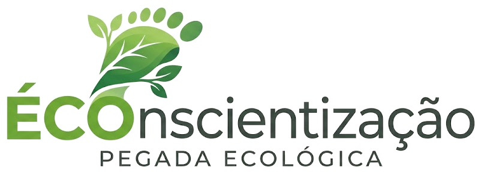

<p align="center">
  
</p>

# ECOnscientização

Projeto acadêmico de Web Design desenvolvido na Facens com o
objetivo de apresentar informações e ferramentas que incentivem
hábitos mais sustentáveis.

A aplicação reúne conteúdos sobre consumo consciente, coleta
seletiva, cálculo de impacto ambiental e organizações que atuam
na proteção do meio ambiente.

## Aplicação publicada

Acesse o projeto:

[ECOnscientização](https://econscientizacao.vercel.app/)

## Funcionalidades

### Página inicial

- Apresentação do projeto.
- Explicação dos 4 Rs da sustentabilidade.
- Informações sobre coleta seletiva.
- Desafio semanal de atitudes sustentáveis.
- Navegação para as demais páginas.

### Calculadora ecológica

- Estimativa de emissões relacionadas à rotina.
- Dados de transporte, energia e gás.
- Validação acessível dos campos.
- Resultado mensal e anual.
- Comparação entre cenários.
- Dicas relacionadas à categoria de maior impacto.

### Blog

- Artigos sobre água, reciclagem e biodiversidade.
- Busca por palavras.
- Busca com ou sem acentuação.
- Filtros por categoria.
- Contagem dinâmica de resultados.
- Mensagem para pesquisas sem correspondência.
- Ilustrações próprias em SVG.
- Fontes e referências em cada artigo.

### ONGs

- Apresentação de organizações ambientais.
- Informações para conhecer e avaliar iniciativas.
- Logos e cartões temáticos.
- Orientações relacionadas a apoio e doação.
- Conteúdo acessível e otimizado para mecanismos de busca.

## Tecnologias utilizadas

- HTML5 para estrutura semântica.
- CSS3 para estilos, Flexbox, Grid e responsividade.
- JavaScript para interatividade e manipulação do DOM.
- Node.js para execução dos testes automatizados.
- Git e GitHub para controle de versão.
- GitHub Pull Requests para revisão e integração.
- Trello para organização do backlog.
- Vercel para publicação da aplicação.

## Estrutura do projeto

```text
ECOnscientizacao/
├── blog/
│   ├── biodiversidade/
│   ├── consumo-de-agua/
│   ├── img/
│   ├── modelo-artigo/
│   ├── reciclagem/
│   ├── index.html
│   ├── planejamento.md
│   ├── script.js
│   └── style.css
├── calculadora/
│   ├── CALCULADORA.md
│   ├── calculadora-modelo.js
│   ├── calculadora.css
│   ├── calculadora.html
│   └── calculadora.js
├── ongs/
│   ├── ongs.css
│   ├── ongs.html
│   └── planejamento-ongs.md
├── resources/
│   ├── fonts/
│   └── img/
├── tests/
│   └── calculadora.test.cjs
├── index.html
├── style.css
└── README.md
```

## Como executar localmente

Clone o repositório:

```bash
git clone https://github.com/FelipeTeoS/ECOnscientizacao.git
```

Entre na pasta:

```bash
cd ECOnscientizacao
```

Abra o projeto no VS Code:

```bash
code .
```

Para visualizar o site, abra `index.html` com uma extensão de
servidor local, como Live Server.

## Testes

Para conferir a sintaxe dos arquivos JavaScript:

```bash
node --check blog/script.js
node --check calculadora/calculadora.js
```

Para executar os testes automatizados da calculadora:

```bash
node --test tests/calculadora.test.cjs
```

A revisão atual possui 9 testes automatizados aprovados.

## Acessibilidade

O projeto utiliza práticas como:

- HTML semântico.
- Hierarquia de títulos.
- Link para pular ao conteúdo.
- Rótulos associados aos campos.
- Navegação por teclado.
- Foco visível nos elementos interativos.
- Textos alternativos em imagens informativas.
- Imagens decorativas com texto alternativo vazio.
- Informações dinâmicas anunciadas com `aria-live`.
- Estado dos filtros identificado com `aria-pressed`.
- Layout adaptável para diferentes telas.
- Suporte à preferência por movimento reduzido.

## Processo de desenvolvimento

As atividades foram organizadas em um backlog no Trello. O
desenvolvimento utilizou branches específicas para cada tarefa,
commits descritivos e pull requests antes da integração na
branch `main`.

Prefixos utilizados nos commits:

- `feat`: nova funcionalidade.
- `fix`: correção de problema.
- `style`: alteração visual.
- `refactor`: reorganização do código.
- `docs`: documentação.

## Versionamento

O projeto utiliza Versionamento Semântico:

```text
MAJOR.MINOR.PATCH
```

- `MAJOR`: mudança incompatível.
- `MINOR`: nova funcionalidade compatível.
- `PATCH`: correção compatível.

Principais versões publicadas:

| Versão | Marco |
|---|---|
| `v0.1.0` | Estrutura inicial do projeto |
| `v0.2.0` | Página inicial e identidade visual |
| `v0.3.0` | Integração visual dos módulos |
| `v0.12.6` | Página de ONGs consolidada |
| `v0.13.0` | Renovação visual da página de ONGs |
| `v0.14.4` | Acessibilidade, SEO e desempenho |
| `v0.15.0` | Busca, filtros e ilustrações no blog |

Consulte o histórico completo em:

[Tags e Releases](https://github.com/FelipeTeoS/ECOnscientizacao/releases)

## Equipe

| Integrante | Responsabilidade principal |
|---|---|
| Iago Bocardi | Blog |
| Kauã Reis | Calculadora ecológica |
| Felipe Teodoro Soares | Página de ONGs |
| Lorenzo (`LorenzoPdL`) | Página inicial |

O desenvolvimento também envolveu integração, revisão e resolução
colaborativa de conflitos entre os integrantes.

## Contexto acadêmico

Projeto desenvolvido para a disciplina de Web Design da Facens,
em 2026.